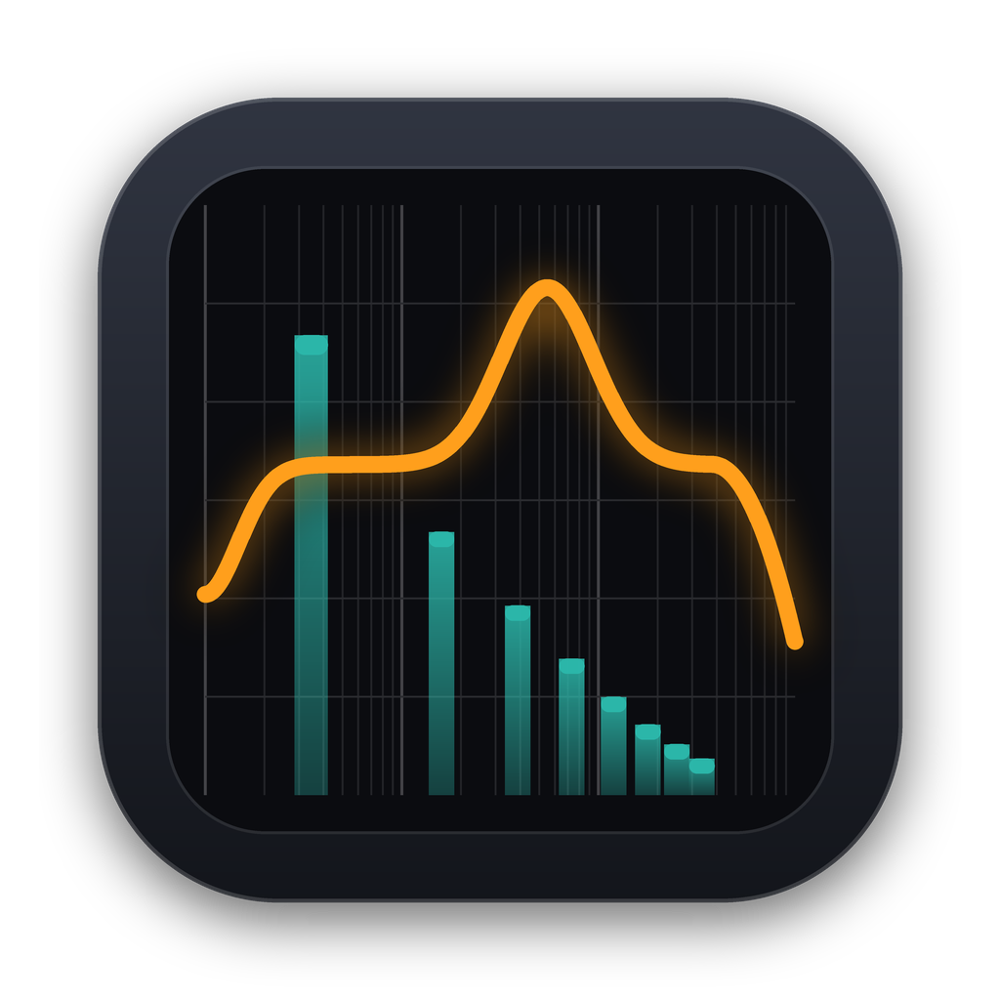

<p align="center">
  
</p>

<h1 align="center">Plugin Analyzer</h1>

用來量測 VST3 / AU 音訊插件行為的獨立程式（macOS / Windows）。
把插件放進兩條 chain（各 6 個 slot），程式會持續送測試訊號進去、分析輸出，並即時更新圖表。

> 本專案依公開的 DSP 量測方法自行撰寫（clean-room），沒有參考任何第三方分析軟體的程式碼。

## 功能

> 第一次使用、不確定每個指標在測什麼？請看 **[指標說明（docs/METRICS.md）](docs/METRICS.md)**：用白話解釋每個分頁、圖表怎麼看、什麼數值算好，以及常見情境該看哪裡。

| 分頁 | 測試訊號 | 顯示內容 |
|---|---|---|
| **Linear** | Delta 脈衝 / 白噪音（H1 互頻譜估計） | 頻率響應、相位、群延遲、脈衝響應、聲道串音（L→R / R→L） |
| **Harmonic** | 單頻正弦（對齊奇數 FFT bin）、SMPTE IMD（60 Hz + 7 kHz）、逐點掃頻、連續掃頻、電平掃描 | 頻譜、THD、THD+N、H2–H9（dBc）、IMD；THD／增益／非諧波（混疊）對頻率；THD+N／THD／增益對輸入電平；2D 時頻圖（看得出混疊） |
| **Oscilloscope** | 正弦／方波／鋸齒波／三角波 | 時間波形；Waveshaper 模式（輸入 vs 輸出，可調延遲） |
| **Dynamics** | 階梯式電平正弦；三段式 attack/release | 轉移曲線（上升與下降，看遲滯）、包絡、約略的 attack/release 時間 |
| **Hammerstein** | 同步指數掃頻（Novak et al.） | 各階 Hammerstein 濾波器 G1–G7、諧波響應 H1–H7 |
| **Reverb** | 長脈衝（1–20 s） | IR、包絡、Schroeder EDC、RT60（T20/T30）、EDT、2D 瀑布圖 |
| **Performance** | 不同 block size（16–4096） | 處理時間占即時的百分比；有訊號 vs. 訊號後的靜音（檢查 denormal 拖慢） |
| **Specs** | 一組標準測試 | 規格表（見下方），可一鍵複製成 TSV 貼到試算表 |

### Specs 規格表內容
| 類別 | 指標 |
|---|---|
| Level & latency | 997 Hz −20 dBFS 增益、回報的延遲、補償後的脈衝峰位置（抓出回報錯誤的延遲）、輸出 DC offset |
| Frequency response | 20 Hz–20 kHz 偏差（±dB）、−3 dB 點 |
| Distortion | THD / THD+N（−1 dBFS、−20 dBFS）、SMPTE IMD、5 kHz 與 10 kHz 的非諧波成分（混疊 + 雜訊） |
| Noise | 靜音輸入的輸出雜訊（未加權 / A 加權）、AES17 動態範圍（−60 dBFS、A 加權） |
| Stereo | L/R 增益差、L→R / R→L 串音（1 kHz、10 kHz） |
| Peak | True peak（4 倍頻帶限制重建）、inter-sample overshoot |
| CPU | 512 樣本 block 的有訊號 / 靜音 CPU 及倍率 |

其他功能：
- **1|2 / 1-2**：同時顯示兩條 chain，或顯示 chain1 − chain2 的差值（null test）。
- **L/R / M/S**：切換左右聲道或 Mid/Side 分析。
- 自動延遲補償（依插件回報的 latency）。
- Store / Clear 儲存比較曲線；拖曳框選放大；往左上拖曳或雙擊重設；觸控板捲動平移；⌘/Ctrl + 滾輪或雙指縮放。
- 截圖存成 PNG、插件掃描清單、下次啟動自動還原上次載入的插件與參數。
- 內建測試處理器（Gain、Peak EQ、Tanh 飽和、多項式、硬削波、壓縮器、延遲、簡易殘響），用來驗證或學習各種圖的意義。
- 命令列啟動時可直接載入插件：
  `"Plugin Analyzer.app/Contents/MacOS/Plugin Analyzer" /path/to/MyPlugin.vst3`

## 命令列（CLI）與 JSON

`plugin-analyzer-cli` 不開介面，直接量測並輸出 JSON，適合寫腳本、放進 CI，或給 LLM 使用（MCP server 也用同一套格式）。

```bash
plugin-analyzer-cli measure thd --plugin builtin:saturator --param 1.1.drive=6 --points 0 --pretty
```

完整說明請看 **[docs/CLI.md](docs/CLI.md)**。

### 給 LLM 使用（MCP）
`plugin-analyzer-cli mcp` 是一個 MCP server，接上 Claude 等 LLM 用戶端後，就能用自然語言要它量測插件，例如「比較這兩個壓縮器的 attack 時間」。

```bash
claude mcp add plugin-analyzer -- /完整路徑/plugin-analyzer-cli mcp
```

LLM 也可以操作**你正在用的視窗**（App，或 Pro Tools 等 DAW 裡的插件）：讀取你的設定、量測、調參數、擷取畫面。這個功能要先在 Settings 勾選「Allow LLM control (MCP)」才會開啟。

設定方式、提供的工具和安全性說明，請看 **[docs/MCP.md](docs/MCP.md)**。

## 插件版（AAX / VST3 / AU）

分析器也可以當作插件，直接在 DAW 裡使用：

| 平台 | 格式 |
|---|---|
| macOS | AAX、VST3、AU |
| Windows | AAX、VST3 |

- 介面、功能和獨立 app 完全相同（兩條 chain、所有分析分頁）。量測使用程式自己產生的測試訊號。
- **邊聽邊看**：右上角的 **Off / Play 1 / Play 2** 決定 DAW 軌道上聽到什麼。
  - Off：原音
  - Play 1 / Play 2：DAW 的音訊經過該條 chain 的插件
  - 三種模式的延遲已經對齊（對 DAW 回報兩條 chain 中較大的延遲，較短的路徑自動補延遲），播放中切換也不會錯位，可以直接 A/B 比較。
- 運作方式：每個 slot 有兩個插件實例，一個給量測、一個處理 DAW 音訊。你在插件視窗調整的參數會即時同步到另一個實例；非參數的狀態（模式切換、載入的檔案等）每 0.5 秒比對一次，有變動就同步。
- 只有在插件視窗打開時才會量測；關掉視窗就暫停量測，但 Play 1 / Play 2 的音訊處理會繼續。
- 載入的插件和它們的參數會存進 DAW 專案，重新開啟專案時自動還原。
- 廠商代碼 `Hmsc`、插件代碼 `Plan`，AU 名稱為「HMusic: Plugin Analyzer」。

## 建置

需求：CMake 3.22 以上、C++20 編譯器（Xcode 或 Visual Studio 2022）。

```bash
# macOS
cmake -S . -B build -G Ninja -DCMAKE_BUILD_TYPE=Release
cmake --build build
./build/PluginAnalyzerTests_artefacts/Release/PluginAnalyzerTests   # 量測數學的自動測試
open "build/PluginAnalyzer_artefacts/Release/Plugin Analyzer.app"
```

```bat
:: Windows（Developer PowerShell / cmd）
cmake -S . -B build -G "Visual Studio 17 2022" -A x64
cmake --build build --config Release
build\PluginAnalyzerTests_artefacts\Release\PluginAnalyzerTests.exe
```

如果 `~/JUCE` 存在就會直接使用，或用 `-DJUCE_DIR=/path/to/JUCE` 指定；否則會自動下載 JUCE 8.0.6（已內附 AAX SDK，不需另外下載）。
產出位置：
- App：`build/PluginAnalyzer_artefacts/Release/`
- 插件：`build/PluginAnalyzerPlugin_artefacts/Release/{VST3,AU,AAX}/`

只想編其中一部分時，可以用 `-DPLUGIN_ANALYZER_BUILD_APP=OFF`、`-DPLUGIN_ANALYZER_BUILD_PLUGIN=OFF`、`-DPLUGIN_ANALYZER_BUILD_CLI=OFF`、`-DPLUGIN_ANALYZER_BUILD_TESTS=OFF` 關掉。

### GitHub Actions
**什麼時候會建置：**

| 動作 | 是否建置 |
|---|---|
| push / PR 改到 `Source/`、`Tests/`、`Resources/`、`CMakeLists.txt`、`.github/workflows/build.yml` | ✅ 建置並測試 |
| 只改文件（`README.md`、`ACKNOWLEDGEMENTS.md`、`LICENSE`、`third_party_licenses/`、`tools/`、`.gitignore`） | ❌ 不建置 |
| 推送 `v` 開頭的標籤（例如 `v1.2.0`） | ✅ 一律建置，並自動發佈 GitHub Release |
| 在 Actions 頁面手動按「Run workflow」 | ✅ 建置 |

**發佈新版本：**
```bash
git tag v1.2.0
```
```bash
git push origin v1.2.0
```
- 標籤上的版本號會寫進 App 和插件（`v1.2.0` → 1.2.0）。
- 兩個平台都建置成功、測試都通過之後，才會建立 Release，附上所有 zip（檔名包含版本，例如 `PluginAnalyzer-v1.2.0-macOS-VST3.zip`），再加一個授權檔案的 zip。GitHub 會自動附上完整原始碼。
- 標籤帶 `-` 的（例如 `v1.2.0-beta.1`）會標成 pre-release；版本號只取數字部分（1.2.0）。
- 本機建置的預設版本是 0.1.0，也可以用 `-DPLUGIN_ANALYZER_VERSION=1.2.3` 指定。

**每次建置的內容：** 推到 GitHub 後，`.github/workflows/build.yml` 會同時建置 macOS（universal：arm64 + x86_64）與 Windows x64，執行測試，並上傳兩個 artifact：

| Artifact | 內容 |
|---|---|
| `PluginAnalyzer-macOS` | `PluginAnalyzer-macOS-App.zip`、`-VST3.zip`、`-AU.zip`、`-AAX-unsigned.zip`、`-CLI.zip` |
| `PluginAnalyzer-Windows` | `PluginAnalyzer-Windows-App.zip`、`-VST3.zip`、`-AAX-unsigned.zip`、`-CLI.zip` |

注意：
- **AAX 沒有簽署**。下載後請用 PACE wraptool 簽署，Pro Tools 才會載入。
- macOS 的 app 和插件只有 ad-hoc 簽章，沒有 Developer ID 簽署和公證。從瀏覽器下載後，macOS 會加上隔離標記。自己測試時可以執行 `xattr -dr com.apple.quarantine "Plugin Analyzer.vst3"`（AU、app 同理）；要給別人用則需要 Developer ID 簽署並公證。

## 程式結構

```
Source/
  analysis/   量測演算法（不依賴 GUI，可單獨測試）
    Dsp.*            FFT、視窗、對數頻率抽樣、STFT
    Measurements.*   各分頁的量測
  host/       插件 chain、內建測試處理器、渲染器（含延遲補償與差值）
  engine/     背景量測執行緒
  core/       App 與插件共用的核心（設定、插件載入、Play 路由與實例同步）
  api/        JSON 請求／回應介面（CLI 與 MCP server 使用）
  live/       讓本機工具（MCP）操作正在執行的 App 或插件
  cli/        plugin-analyzer-cli 的進入點和 MCP server
  plugin/     插件版的 AudioProcessor 與編輯器
  ui/         圖表、chain 面板、各分頁、設定
docs/         METRICS.md：每個指標的白話說明；CLI.md：命令列與 JSON 格式；MCP.md：MCP server
Resources/    App 圖示（icon.png，由 tools/make_icon.py 產生）
Tests/        AnalysisTests：以已知行為的處理器驗證量測結果
              PluginSmokeTest：像 DAW 一樣載入編好的 VST3，驗證 Play 路由、增益與延遲回報
              mcp_smoke.py：用 MCP 協定完整測試 MCP server
              live_smoke.py：透過 MCP 操作正在執行的視窗（本機執行）
```

## 授權

本專案自行撰寫的原始碼（`Source/`、`Tests/`、CMake 設定、CI 設定與文件）採用 **[MIT 授權](LICENSE)**。

不過，編譯出來的 app 包含 JUCE（AGPLv3／商業授權二擇一）和 Steinberg VST3 SDK 等第三方元件。所以：
- **原始碼**：本專案的檔案可以依 MIT 自由使用、修改、併入其他專案。
- **編譯後的執行檔**：沒有 JUCE 商業授權時，整體要依 **AGPLv3** 散布（包括提供完整原始碼）。MIT 與 AGPLv3 相容，所以兩者並不衝突。

## 致謝

本程式使用 JUCE 8（AGPLv3／商業授權二擇一）及其內附的 VST3 SDK、HarfBuzz、libpng、IJG libjpeg、zlib 等套件；
Hammerstein、殘響、IMD 等量測方法則依公開文獻實作。完整清單、引用文獻和授權原文請見
[ACKNOWLEDGEMENTS.md](ACKNOWLEDGEMENTS.md) 和 [third_party_licenses/](third_party_licenses/)。

This software is based in part on the work of the Independent JPEG Group.

## 已知限制
- 插件掃描在同一個程序內進行（有 crash 黑名單，但掃到會當機的插件時，app 仍可能跟著當掉）。
- 尚未支援外接硬體量測。
- 插件版每個 slot 會載入兩個實例，記憶體和 CPU 用量大約是單一實例的兩倍。
- 非參數狀態的同步會有最多約 0.5 秒的延遲；同步的那一個 block 會以原音通過（避免卡住 DAW 的音訊執行緒）。
- 不支援 VST2 / AAX 插件。
- JUCE 8 採 AGPLv3 或商業授權；若要對外發佈，需要遵守其中一種授權。
